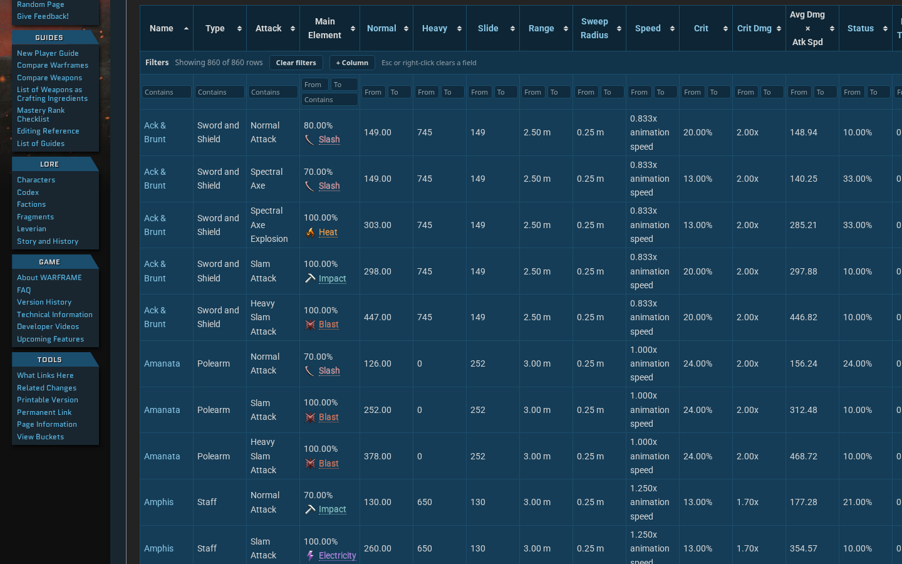
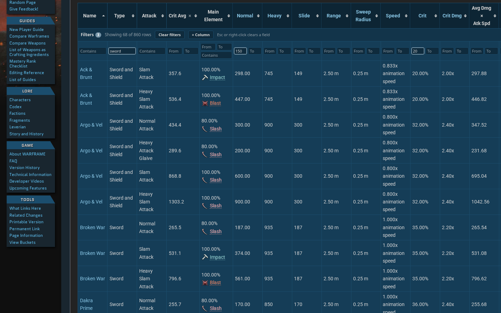

# Warframe Wiki Table Filters

A userscript that adds per-column filters and custom computed columns to tables on the [Warframe Wiki](https://wiki.warframe.com/).



## Features

- **Automatic column detection.** Each column is sampled and given a filter that fits its contents:
  - **Numbers:** a From / To range
  - **Dates:** a From / To date range (the To date includes the whole day)
  - **Text:** a "Contains" search
  - **Mixed:** a range and a text search together
- **Works with sorting.** Filters stay in place when you sort with the wiki's own tablesorter.
- **Live count.** The table shows how many rows match and how many filters are active.
- **Quick clearing.** Press <kbd>Esc</kbd> or right-click a filled field to clear it. "Clear filters" resets the whole table.
- **Custom columns.** Click **+ Column** to add a computed column, for example:

  ```
  Normal * (1 + Crit / 100 * ([Crit Dmg] - 1))
  ```

  - Refer to columns by name. Spaces and symbols are ignored, or you can write `[Exact Name]`.
  - Operators: `+ - * / % ^` and comparisons `> < >= <= == !=`
  - Functions: `if(cond, a, b)`, `min`, `max`, `abs`, `round(x, digits)`, `floor`, `ceil`, `sqrt`
  - Rows where a referenced cell has no number stay empty.
- **Persistence.** Custom columns are kept in `localStorage`. Filter values are kept in `sessionStorage` for the current tab.

Tables with fewer than 5 rows are skipped, since they're easy enough to scan without filters.



## Installation

1. Install a userscript manager such as [Tampermonkey](https://www.tampermonkey.net/) or [Violentmonkey](https://violentmonkey.github.io/).
2. [Click here to install](https://raw.githubusercontent.com/nicolindenlauf/warframe-table-filters/main/warframe-wiki-table-filters.user.js). Your userscript manager will open an install prompt and keep the script updated.
3. Visit any page on `wiki.warframe.com` that has a table, such as a weapon comparison.

## Development

The tests use [Playwright](https://playwright.dev/) with Chromium and Node's built-in test runner:

```sh
npm install playwright          # or set PLAYWRIGHT_PATH to an existing install
npx playwright install chromium
node --test tests/*.test.js
```

`tests/live-pages.test.js` loads real wiki pages, so it needs network access.
